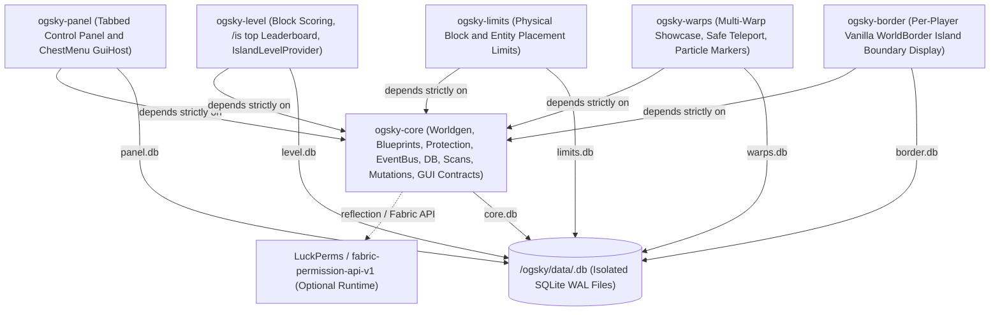
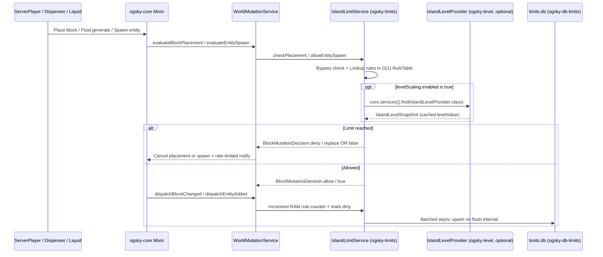

# Ogsky Module Architecture, Wiring & Extension Guide (`docs/modules.md`)

This document explains how `modules/core` (`ogsky-core`) and the optional feature modules (`border`, `panel`, `level`, `limits`, `warps`) wire together at compile time and runtime without violating module isolation, and documents each module's configuration, commands, permissions, SQLite schema, and step-by-step extension pattern.

Related specs:
- [Core Public API Reference](core-api.md)
- [Architecture Overview](architecture.md)
- [Flags, Protections, Commands & Domain Events](flags-and-events.md)
- [Shared Declarative GUI API](gui-api.md)
- [Island & World Specification](island-spec.md)

---

## 1. Compile-Time Modular Bundling (`-Pmodules=...`)

Ogsky builds on a multi-project Gradle workspace (`settings.gradle`) where every optional module is compiled independently against `:modules:core` and selectively packaged via Fabric Jar-in-Jar (`include`):

- **Allowed modules (`build.gradle` `availableModules`):** `core`, `panel`, `level`, `limits`, `warps`, `border`
- **Default enabled bundle (`gradle.properties` `enabled_modules`):** `core,panel,level,limits,warps,border`
- **`core` invariant:** `core` is always added to `selectedModules` automatically, even if omitted from `-Pmodules=...`. Unknown module names fail fast at configuration time.

```bash
# Minimal headless core server (no panel, level, or limits)
./gradlew build -Pmodules=core

# Core + Limits without GUI panel (commands use chat fallback)
./gradlew build -Pmodules=core,limits

# Full default bundle
./gradlew build
```

---

## 2. Module Isolation & Cross-Module Connection Map

**Golden Boundary Rule ([`AGENTS.md`](../AGENTS.md)):**
1. `modules/core` MUST NEVER depend on or import any optional module.
2. Optional modules MUST depend **only** on `:modules:core` (`implementation project(':modules:core')`) and MUST NEVER depend on or import one another.
3. All inter-module coordination occurs via `OgskyCore.api()` (`events()`, `services()`, `actions()`, `guis()`, `flags()`, `commands()`, `scans()`, `mutations()`, `databases()`, `permissions()`, `islands()`).



### Deterministic Load Order (`OgskyCoreMod`)

`OgskyCoreMod` loads all `"ogsky-module"` entrypoints sorted alphabetically by `OgskyModule.moduleId()`:

1. `core` initializes config, registries, built-in flags, and built-in actions (`island_home`, `island_home_nether`, `island_home_end`, `island_sethome`, `island_toggle_lock`).
2. `border` (`moduleId = "border"`) registers `border.db`, `IslandBorderService`, `/is border` & `/isadmin border` commands, dynamic `ogsky_border:toggle_border` panel action, `ogsky_border:summary`, and player/island lifecycle sync listeners.
3. `level` (`moduleId = "level"`) registers `level.db`, `IslandLevelService`, `IslandLevelProvider`, commands, GUI screens, actions, summary contributor, and event listeners.
4. `limits` (`moduleId = "limits"`) registers `limits.db`, flag `ogsky_limits:view_limits`, `IslandLimitService`, all 4 `WorldMutationService` hooks, commands, GUI screen, action, summary contributor, and event listeners.
5. `panel` (`moduleId = "panel"`) registers `panel.db`, `PanelViewModelService`, `PanelController`, `PanelGuiHost` into `core.guis().registerHost(...)`, `/is panel` & `/is settings`, and event refresh listeners.
6. `warps` (`moduleId = "warps"`) registers `warps.db`, flags `ogsky_warps:manage_warps` & `ogsky_warps:use_warp`, `IslandWarpService`, `/is warp` & `/is warps` & `/is setwarp` & `/is delwarp`, GUI screens, actions, summary contributor, particle marker/warmup tick handlers, and lifecycle listeners.
7. `core` freezes `FlagRegistry`, initializes `WORLD_SETTING` defaults, and mounts Brigadier `/is` & `/isadmin` subcommands.

### Cross-Module Wiring Matrix

| Capability / Contract | Provider Module | Registered ID / Contract | Consumer Modules & Behavior |
| :--- | :--- | :--- | :--- |
| **Action Entries (`/is panel` Actions Tab)** | `core` | `ogsky:island_home` (10), `ogsky:island_home_nether` (12), `ogsky:island_home_end` (14), `ogsky:island_sethome` (16), `ogsky:island_toggle_lock` (18) | Rendered by `ogsky-panel` (`PanelViewModelService`) in `ACTIONS` tab. |
| **Action Entries** | `border` | `ogsky_border:toggle_border` (19) with dynamic `IslandActionPresenter` | Rendered by `ogsky-panel` in `ACTIONS` tab with live `ON`/`OFF` badge & colored glass icon. |
| **Action Entries** | `level` | `ogsky:island_level` (20), `ogsky_level:island_top` (22), `ogsky_level:block_values` (24) | Rendered by `ogsky-panel`; opens `core.guis()` screens or falls back to chat if absent. |
| **Action Entries** | `limits` | `ogsky_limits:island_limits` (30) | Rendered by `ogsky-panel`; opens `ogsky_limits:overview` or falls back to chat. |
| **Action Entries** | `warps` | `ogsky_warps:showcase` (40), `ogsky_warps:manage_warps` (42) | Rendered by `ogsky-panel`; opens showcase/management screens or falls back to chat. |
| **Slot-8 Island Summary Contributors** | `level`, `limits`, `warps`, `border` | `ogsky_level:summary` (`20`), `ogsky_limits:summary` (`30`), `ogsky_warps:summary` (`40`), `ogsky_border:summary` (`50`) | Collected dynamically via `core.guis().collectSummaryLines(ctx)` by `OgskyPanelMenu` slot `8`. |
| **Custom Declarative Screens** | `level`, `limits`, `warps` | `ogsky_level:top`, `ogsky_level:detail`, `ogsky_level:values`, `ogsky_limits:overview`, `ogsky_warps:showcase`, `ogsky_warps:manage`, `ogsky_warps:edit` | Rendered via `PanelGuiHost` (`OgskyCustomGuiMenu`) when `ogsky-panel` is loaded (`core.guis().isAvailable()`). |
| **GUI Host (`GuiHost`)** | `panel` | `PanelGuiHost` registered on `core.guis()` + `GuiService.MAIN_PANEL_SCREEN_ID` (`ogsky:main_panel`) | Used transparently by `level`, `limits`, and `warps` via `core.guis().openScreen(...)` & `refreshIslandScreens(...)`. |
| **Optional Service (`ServiceRegistry`)** | `level` | `IslandLevelProvider` (`core.services().find(IslandLevelProvider.class)`) | Consumed optionally by `limits` (limit scaling) and `warps` (Island Level showcase sorting & lore). |
| **Custom Flags (`FlagRegistry`)** | `limits`, `warps` | `ogsky_limits:view_limits`, `ogsky_warps:manage_warps`, `ogsky_warps:use_warp` | Appear automatically in `/is flags`, `/is flag`, and `ogsky-panel`'s Protection Flags tab! |
| **3D Tick-Budgeted Scans (`core.scans()`)** | `core` | `scanIsland(...)`, `scanIslandWithEntities(...)` | Consumed by `level` (blocks) and `limits` (blocks + loaded & disk entities). |
| **World Mutation Interceptors (`core.mutations()`)** | `core` | `BlockPlacementGuard`, `BlockChangeObserver`, `EntitySpawnGuard`, `EntityLifecycleObserver` | Registered by `limits` (`IslandLimitService`) for real-time limit enforcement and incremental counter deltas. |

### Domain Event Wiring Across Modules

| Event | Published By | Subscribed By | Effect |
| :--- | :--- | :--- | :--- |
| `BlueprintPasteCompletedEvent` | `core` | `level`, `limits` | `level` auto-calculates initial level (if `autoScanOnPasteComplete`); `limits` schedules initial 3D block & entity scan (if `autoScanOnBlueprintComplete`). |
| `IslandResetEvent` | `core` | `core` (`scanService`), `level`, `limits`, `panel`, `warps`, `border` | Cancels active scans, clears old level/limit/warp state & DB rows, refreshes open panel menus and re-syncs player borders. |
| `IslandDeletedEvent` | `core` | `core` (`scanService`), `level`, `limits`, `panel`, `warps`, `border` | Cancels active scans, deletes per-island rows in `level.db`, `limits.db`, and `warps.db`, closes open panel/GUI menus, and clears deleted island borders. |
| `IslandRangeChangeEvent` | `core` | `limits`, `panel`, `warps`, `border` | `limits` schedules async rescan for resized bounds; `warps` & `panel` refresh open menus; `border` re-syncs client border sizes live. |
| `IslandLevelCalculatedEvent` | `level` | `panel` | Triggers `scheduleIslandRefresh(islandId)` so slot `8` summary shows the updated level live. |
| `TeamOwnerChangeEvent` | `core` | `panel`, `warps` | `panel` refreshes open menus; `warps` recalculates owner warp cap snapshot and refreshes GUI owner head/labels. |
| `IslandLockChangedEvent`, `IslandProtectionFlagChangedEvent`, `IslandSettingFlagChangedEvent`, `IslandBanEvent`, `IslandUnbanEvent`, `TeamJoinEvent`, `TeamKickEvent`, `TeamLeaveEvent`, `TeamRankChangeEvent` | `core` | `panel` | Refreshes open `OgskyPanelMenu` instances for affected islands. |

### Runtime Flow: `limits` Pre-Spawn / Placement Check & Optional Level Scaling



---

## 3. Per-Module Specifications (Config, Commands, Permissions & SQLite)

### 3.1 `modules/core` (`ogsky-core`)

#### Configuration: `config/ogsky/core.json` ([`CoreConfig`](../modules/core/src/main/java/me/ogsammaenr/ogsky/core/internal/config/CoreConfig.java))
- `grid.cellSize`: `1024` *(locked into `core.db` `world_meta` after the first island is created; must be `>= 32` and a multiple of `16`)*.
- `island`: `initialHalfSize` (`50`), `maxHalfSize` (`480`, strictly `< cellSize / 2`), `defaultSpawnY` (`64`, range `-64..319`).
- `roles.names`: Map `"0".."6"` to custom display names (`Ziyaretçi`, `Coop`, `Güvenilir`, `Üye`, `Yönetici`, `Sahip`, `Devre Dışı` by default).
- `membership`: `maxCoop` (`1`), `maxTrusted` (`2`), `inviteTimeoutSeconds` (`60`, minimum `5`).
- `blueprints`: `defaultBundle` (`"default"`), `blocksPerTick` (`256`), `maxNanosPerTick` (`2000000`), `cleanupChunksPerTick` (`2`), `lazyNether` (`true`), `lazyEnd` (`true`), `welcomeSignLines` (4 lines supporting `&` color codes & `{player}` placeholder).
- `voidTeleport.mode`: `"ISLAND_HOME"` or `"WORLD_SPAWN"`.
- `admin.fallbackOpLevel`: `2` (`0..4`).
- `flags`: `protectionDefaults`, `settingDefaults`, `worldSettingDefaults`, `wildernessAllow` maps overriding built-in flag defaults.

#### Blueprint Bundles: `config/ogsky/blueprints/<bundleId>/bundle.json` ([`BlueprintBundleMetadata`](../modules/core/src/main/java/me/ogsammaenr/ogsky/core/internal/blueprint/BlueprintBundleMetadata.java))
- Fields: `id`, `displayName`, `description`, `iconItem` (`"minecraft:grass_block"`), `requiresPermission` (`false`), `permissionNode` (`"ogsky.blueprint.<id>"` when required and blank), `order` (`0`), plus dimension specs `overworld` (`overworld.nbt`), `nether` (`nether.nbt`), `end` (`end.nbt`), each containing `file`, `centerHorizontally`, `offsetX/Y/Z`, `spawnOffsetX/Y/Z`, `spawnYaw`, `spawnPitch`.

#### Commands & Permissions ([`OgskyCommands`](../modules/core/src/main/java/me/ogsammaenr/ogsky/core/internal/command/OgskyCommands.java))
All player commands sit under `/island` (alias `/is`); admin commands sit under `/isadmin` (alias `/isa`, gated by `ogsky.admin` / OP `config.admin.fallbackOpLevel`):

- **Player (`/is` / `/island`):**
  - `/is` (teleport Overworld home), `help` (`ogsky.command.help`), `create [bundle]` (`ogsky.command.create` + blueprint node `ogsky.blueprint.<bundle>`), `reset [bundle]` (`ogsky.command.reset`), `delete [confirm]` (`ogsky.command.delete`), `home [overworld|nether|end]` (`ogsky.command.home`), `sethome` (`ogsky.command.sethome`), `info [player]` (`ogsky.command.info`), `members` (`ogsky.command.members`), `invite <player>` (`ogsky.command.invite`), `accept` (`ogsky.command.accept`), `deny` (`ogsky.command.deny`), `cancel <player>` (`ogsky.command.cancel`), `kick <player>` (`ogsky.command.kick`), `leave` (`ogsky.command.leave`), `coop <player>` (`ogsky.command.coop`), `uncoop <player>` (`ogsky.command.uncoop`), `trust <player>` (`ogsky.command.trust`), `untrust <player>` (`ogsky.command.untrust`), `promote <player>` (`ogsky.command.promote`), `demote <player>` (`ogsky.command.demote`), `transfer <player>` (`ogsky.command.transfer`), `ban <player>` (`ogsky.command.ban`), `unban <player>` (`ogsky.command.unban`), `lock [true|false]` (`ogsky.command.lock`), `flags` / `flag <flag> <value>` (`ogsky.command.flags`).
- **Admin (`/isadmin` / `/isa`, perm `ogsky.admin`):**
  - `help`, `reload`, `delete <owner>`, `setrange <owner> <halfSize>`, `tp <owner> [dimension]`, `info <owner>`, `bypass` (session toggle), `worldflags`, `worldflag <flag> <enabled>`.
- **Bypass Permissions:** `ogsky.admin.bypass.<flagPath>` or `ogsky.admin.bypass.*`.

#### SQLite Schema (`<world>/ogsky/data/core.db`, moduleId `"core"`)
- `ogsky_schema_migrations(version PK, description, applied_at)` *(shared metadata table created per DB by `SqliteModuleDatabase`)*
- `world_meta(meta_key PK, meta_value)` — locks `grid.cell_size`
- `islands(island_id PK, owner_uuid, center_x, center_z, created_at, grid_x, grid_z, half_size, bundle_id, lifecycle_mask, rel_ow_x/y/z/yaw/pitch, rel_nether_x/y/z/yaw/pitch, rel_end_x/y/z/yaw/pitch, updated_at)` + indexes `idx_islands_owner`, `idx_islands_grid`
- `island_members(island_id, player_uuid, role, joined_at, PK(island_id, player_uuid))` + index `idx_island_members_player`
- `island_bans(island_id, player_uuid, banned_by, banned_at, PK(island_id, player_uuid))`
- `island_protection_flags(island_id, flag_id, min_rank, PK(island_id, flag_id))`
- `island_setting_flags(island_id, flag_id, enabled, PK(island_id, flag_id))`
- `world_settings(flag_id PK, enabled, updated_at)`
- `grid_cleanup_queue(grid_x, grid_z, min_x, max_x, min_z, max_z, cursor_chunk_x, cursor_chunk_z, created_at, PK(grid_x, grid_z))`

---

### 3.2 `modules/panel` (`ogsky-panel`)

- **Config:** None (`UI preferences` persisted per-player in SQLite).
- **Registered Services:** `PanelPreferenceRepository`, `PanelViewModelService`, `PanelController`, `PanelGuiHost`, plus `core.guis().registerHost(guiHost)`.
- **Panel Tabs (`PanelTab`):** `ACTIONS`, `PROTECTION_FLAGS`, `SETTING_FLAGS`, `MEMBERS`, `BLUEPRINTS_INFO` (`ogsky:main_panel`).
- **Commands & Permissions ([`PanelCommands`](../modules/panel/src/main/java/me/ogsammaenr/ogsky/panel/PanelCommands.java)):**
  - `/is panel [tab]` *(aliases: `gui`, `menu`)* — `ogsky.command.panel` (fallback OP `0`).
  - `/is settings [protections|settings]` *(alias: `setting`)* — `ogsky.command.settings` (fallback OP `0`).
- **Anti-Dupe Host:** `OgskyReadOnlyChestMenu` + `ServerGamePacketListenerImplMixin` (`ogsky_panel_item` marker, offhand/cursor resync, shift/drag/creative rejection, 10-second two-click confirmations).
- **SQLite Schema (`panel.db`, moduleId `"panel"`):**
  - `panel_preferences(player_uuid PK, ui_mode, updated_at, preferred_tab, flag_mode)` (migrations v1–v2).

---

### 3.3 `modules/level` (`ogsky-level`)

- **Configuration: `config/ogsky/level.json` ([`LevelConfig`](../modules/level/src/main/java/me/ogsammaenr/ogsky/level/LevelConfig.java)):**
  - `formula`: `pointsPerLevel` (`100`), `defaultBlockValue` (`0`).
  - `scan`: `cooldownSeconds` (`30`), `chunksPerTick` (`16`), `maxNanosPerTick` (`4000000`), `includeUnloadedChunks` (`true`), `maxInFlightDiskReads` (`8`), `autoScanOnPasteComplete` (`true`).
  - `top`: `maxCachedEntries` (`100`), `chatEntriesPerPage` (`10`), `detailTopBlocksLimit` (`14`, valid `1..21`).
  - `blockValues` & `blockPointLimits`: block IDs and `#tag` entries mapped to point worth and **scoring-only** point caps.
- **Commands & Permissions ([`LevelCommands`](../modules/level/src/main/java/me/ogsammaenr/ogsky/level/LevelCommands.java)):**
  - `/is level [player]` *(alias: `lvl`)* — `ogsky.command.level`
  - `/is top [page]` *(alias: `leaderboard`)* — `ogsky.command.top`
  - `/is values [page | search <query>]` *(aliases: `value`, `worth`)* — `ogsky.command.values`
  - `/isadmin level scan <owner> | scanall | reload` — `ogsky.admin.level` (fallback OP `2`)
  - Cooldown bypass permission: `ogsky.level.bypass_cooldown` (or active `/isadmin bypass`).
- **GUI & Service Integrations:**
  - Service: `IslandLevelService` & `IslandLevelProvider`.
  - Publishes `IslandLevelCalculatedEvent`.
  - Summary: `ogsky_level:summary` (`sortOrder = 20`); Screens: `ogsky_level:top`, `ogsky_level:detail`, `ogsky_level:values`; Actions: `ogsky:island_level` (20), `ogsky_level:island_top` (22), `ogsky_level:block_values` (24).
- **SQLite Schema (`level.db`, moduleId `"level"`):**
  - `island_levels(island_id PK, level_value, block_points, updated_at, top_blocks_json)` + `idx_island_levels_rank` (migrations v1–v2).

---

### 3.4 `modules/limits` (`ogsky-limits`)

- **Configuration: `config/ogsky/limits.json` ([`LimitConfig`](../modules/limits/src/main/java/me/ogsammaenr/ogsky/limits/LimitConfig.java)):**
  - `enforce` (`true`), `countExistingOnFirstAccess` (`true`), `autoScanOnBlueprintComplete` (`true`), `defaultViewLimitsRank` (`"MEMBER"`), `bypassPermission` (`"ogsky.limits.bypass"`), `notifyCooldownMillis` (`1500`).
  - Scanning & persistence: `scanChunksPerTick` (`8`), `scanMaxMillisPerTick` (`4`), `scanIncludeUnloadedChunks` (`true`), `dbFlushIntervalTicks` (`20`).
  - Mechanics: `liquidGeneratorPolicy` (`CANCEL`, `FALLBACK_TO_STONE`, `FULL_FALLBACK_WITH_AIR`), `countBaseMultiBlockPartsOnly` (`true`, skips top halves of beds/doors/double plants and extended piston heads).
  - Optional level scaling: `levelScaling.{enabled=false, bonusPer100Levels=0.1, maxBonusMultiplier=2.0}` *(reads `IslandLevelProvider` dynamically when loaded)*.
  - Rules: `blockLimits` (block IDs / `#tags`), `blockGroups` (`displayName`, `icon`, `limit`, `entries`), `entityLimits` (entity IDs / `#tags`), `entityGroups`. Every matching individual, `#tag`, and custom group bucket increments together ("multi-bucket" accounting).
- **Registered Flag:** `ogsky_limits:view_limits` (`FlagType.PROTECTION`, `FlagMode.BASIC`, default rank parsed from `defaultViewLimitsRank`).
- **Commands & Permissions ([`LimitsCommands`](../modules/limits/src/main/java/me/ogsammaenr/ogsky/limits/LimitsCommands.java)):**
  - `/is limits [page | all [page] | blocks [page] | entities [page] | chat [page] | search <query> [page]]` *(alias: `limit`)* — permission `ogsky.limits` (access on island gated by `ogsky_limits:view_limits` flag).
  - `/isadmin limits reload | rescanall | rescan <player> | inspect <player> [page]` — permission `ogsky.admin.limits` (fallback OP `2`).
  - Placement/spawn limit bypass permission: configurable `bypassPermission` (default `"ogsky.limits.bypass"`) or active `ogsky.admin.bypass.*`.
- **GUI Integrations:**
  - Summary: `ogsky_limits:summary` (`sortOrder = 30`, gated by `canViewLimits`); Screen: `ogsky_limits:overview` (filterable All/Blocks/Entities + sortable Usage%/A-Z/Category + admin Rescan button); Action: `ogsky_limits:island_limits` (30).
- **SQLite Schema (`limits.db`, moduleId `"limits"`):**
  - `ogsky_island_limits(island_id, kind, rule_key, count, updated_at, PK(island_id, kind, rule_key))` + `idx_ogsky_limits_island`
  - `ogsky_limits_meta(island_id PK, rules_hash, synced_at)` *(triggers lazy rescan automatically when `rules_hash` changes across config edits)*.

---

### 3.5 `modules/warps` (`ogsky-warps`)

- **Configuration: `config/ogsky/warps.json` ([`WarpConfig`](../modules/warps/src/main/java/me/ogsammaenr/ogsky/warps/WarpConfig.java)):**
  - `enabled` (`true`), `defaultManageWarpsRank` (`"ADMIN"`), `defaultUseWarpRank` (`"VISITOR"`).
  - Dimensions: `allowOverworld` (`true`), `allowNether` (`true`), `allowEnd` (`true`).
  - Multi-warp limits: `defaultMaxWarpsPerIsland` (`3`), `permissionLimitTiers` (`[1, 3, 5, 10, 15, 25]`, checks `ogsky.warps.limit.<n>` on island owner), `limitBypassPermission` (`"ogsky.warps.limit.unlimited"`).
  - Customization: `maxWarpNameLength` (`24`), `maxDescriptionLength` (`80`), `defaultCategory` (`"general"`), `forbiddenIcons`, `categories` (`general`, `shop`, `farm`, `spawner`, `arena`, `other`).
  - Timing & anti-abuse: `warmupSeconds` (`3`), `cancelWarmupOnMove` (`true`), `warmupMoveToleranceBlocks` (`0.25`), `cancelWarmupOnDamage` (`true`), `cooldownSeconds` (`5`), `bypassWarmupPermission` (`"ogsky.warps.bypass_warmup"`), `bypassCooldownPermission` (`"ogsky.warps.bypass_cooldown"`), `countIslandMembersInVisits` (`false`), `visitCountCooldownSeconds` (`3600`).
  - Particle markers: `markerDurationSeconds` (`30`), `markerIntervalTicks` (`5`), `markerParticle` (`"minecraft:end_rod"`).
- **Registered Flags:**
  - `ogsky_warps:manage_warps` (`FlagType.PROTECTION`, `FlagMode.BASIC`, default `ADMIN`)
  - `ogsky_warps:use_warp` (`FlagType.PROTECTION`, `FlagMode.BASIC`, default `VISITOR`)
- **Commands & Permissions ([`WarpsCommands`](../modules/warps/src/main/java/me/ogsammaenr/ogsky/warps/WarpsCommands.java)):**
  - `/is warp <player> [warp]` — permission `ogsky.command.warp` (no `visit` alias)
  - `/is warps [chat [page] | category <cat> [page] | search <query> | player <player> | mine | manage | show [warp|all|off] | set <name> [cat] | remove <name> | edit <warp> ...]` — permission `ogsky.command.warps`
  - `/is setwarp [name] [category]` — permission `ogsky.command.setwarp`
  - `/is delwarp [name]` — permission `ogsky.command.delwarp`
  - `/isadmin warps reload | inspect <player> | delete <player> <warp> | toggle <player> <warp> <true|false>` — permission `ogsky.admin.warps` (fallback OP `2`).
- **GUI Integrations:**
  - Summary: `ogsky_warps:summary` (`sortOrder = 40`); Screens: `ogsky_warps:showcase` (category tabs + sort cycle Recent/Popularity/Level/Alphabetical + owner-head default / custom hand-item icons), `ogsky_warps:manage`, `ogsky_warps:edit`; Actions: `ogsky_warps:showcase` (`40`), `ogsky_warps:manage_warps` (`42`).
- **SQLite Schema (`warps.db`, moduleId `"warps"`):**
  - `ogsky_warps(island_id, slug, display_name, dimension_id, rel_x, y, rel_z, yaw, pitch, category_id, icon_item_id, description, enabled, is_default, visit_count, created_by, created_at, updated_at, PK(island_id, slug))` + `idx_ogsky_warps_island`
  - `ogsky_warp_island_meta(island_id PK, cached_max_warps, updated_at)`

---

### 3.6 `modules/border` (`ogsky-border`)

- **Configuration: `config/ogsky/border.json` ([`BorderConfig`](../modules/border/src/main/java/me/ogsammaenr/ogsky/border/BorderConfig.java)):**
  - `enabled` (`true`), `defaultEnabledForPlayers` (`false`), `defaultColor` (`"BLUE"`, valid: `BLUE`, `GREEN`, `RED`), `allowColorSelection` (`true`).
  - Dimensions: `allowInOverworld` (`true`), `allowInNether` (`true`), `allowInEnd` (`true`).
  - Client warning thresholds: `warningBlocks` (`0`), `warningTime` (`0`).
- **Commands & Permissions ([`BorderCommands`](../modules/border/src/main/java/me/ogsammaenr/ogsky/border/BorderCommands.java)):**
  - `/is border [on|off|toggle|status|color <blue|green|red>]` — permissions `ogsky.command.border` & `ogsky.command.border.color` (fallback OP `0`).
  - `/isadmin border reload | inspect <player> | toggle <player> [on|off]` — permission `ogsky.admin.border` (fallback OP `2`).
- **Behavior & GUI Integrations:**
  - Sends per-player virtual `ClientboundInitializeBorderPacket` aligned to the occupied island's exact block perimeter (`centerX + 0.5, centerZ + 0.5`, `halfSize * 2 + 1`), automatically updating on island entry/exit, dimension transitions, respawn, and `IslandRangeChangeEvent`, and restoring `level.getWorldBorder()` when toggled off or outside island bounds.
  - Summary: `ogsky_border:summary` (`sortOrder = 50`); Action: `ogsky_border:toggle_border` (`sortOrder = 19`) with dynamic `IslandActionPresenter` (`ON`/`OFF` badge and color-matched glass icon).
- **SQLite Schema (`border.db`, moduleId `"border"`):**
  - `ogsky_border_preferences(player_uuid PK, enabled, color, updated_at)`

---

## 4. Step-by-Step Guide: Adding a New Optional Module (`modules/<name>`)

Follow these steps whenever implementing a new feature module (e.g. `warps`, `challenges`, `upgrades`):

### Step 1: Register the Module in Gradle

1. Add `include 'modules:<name>'` to [`settings.gradle`](../settings.gradle).
2. Add `'<name>'` to `availableModules` in root [`build.gradle`](../build.gradle).
3. *(Optional)* Add `<name>` to `enabled_modules` in [`gradle.properties`](../gradle.properties).
4. Create `modules/<name>/build.gradle`:

```groovy
dependencies {
    implementation project(':modules:core')
}
```

### Step 2: Add Fabric Module Metadata (`modules/<name>/src/main/resources/fabric.mod.json`)

Use `"environment": "server"` and Fabric's `"ogsky-module"` entrypoint (do **not** use `"main"` so `ogsky-core` controls initialization ordering and freezes registries afterward):

```json
{
  "schemaVersion": 1,
  "id": "ogsky-<name>",
  "version": "${version}",
  "name": "Ogsky <Name>",
  "description": "...",
  "environment": "server",
  "entrypoints": {
    "ogsky-module": [
      "me.ogsammaenr.ogsky.<name>.Ogsky<Name>Mod"
    ]
  },
  "depends": {
    "fabricloader": ">=0.20.1",
    "minecraft": "~26.3",
    "java": ">=25",
    "fabric-api": "*",
    "ogsky-core": "*"
  }
}
```

### Step 3: Implement `OgskyModule`

Inside `onLoad(OgskyCoreApi core)`:

1. **Register database schema:** `core.databases().registerModule("<name>", MIGRATIONS)` and store all module state keyed by `UUID island_id` / `UUID player_uuid`.
2. **Subscribe to lifecycle cleanup events:** Always subscribe to `IslandDeletedEvent` (and `IslandResetEvent` if island-scoped state must reset) on `core.events()`. Clear runtime state on `ServerLifecycleEvents.SERVER_STOPPED`.
3. **Register optional flags / commands / actions / GUI:**
   - `core.flags().register(...)` before registries freeze.
   - `core.commands().registerSubcommand(...)` and/or `registerAdminSubcommand(...)`.
   - `core.actions().register(...)` & `core.guis().registerScreen(...)` + `registerSummaryContributor(...)`.
   - Always fall back to chat output whenever `core.guis().openScreen(...)` returns `false`!
4. **Expose cross-module APIs safely (if needed):** Place interfaces/DTOs under `modules/core/src/main/java/me/ogsammaenr/ogsky/core/api/<capability>/` and bind the implementation in `core.services().register(...)` inside `onLoad`. Never let another optional module depend directly on `modules/<name>`.

### Step 4: Add Unit Tests & Headless GameTests

1. Add fast JUnit 5 tests in `modules/<name>/src/test/java/...` using `@TempDir` SQLite roots and `OgskyCoreApiImpl` (keeping test helpers local to each module).
2. Add a dedicated GameTest class under [`src/gametest/java/me/ogsammaenr/ogsky/gametest/`](../src/gametest/java/me/ogsammaenr/ogsky/gametest/) (for example `CoreBootstrapGameTests.java`, `LevelGameTests.java`, `LimitsGameTests.java`) using shared helpers in [`GameTestSupport.java`](../src/gametest/java/me/ogsammaenr/ogsky/gametest/GameTestSupport.java), register it in [`src/gametest/resources/fabric.mod.json`](../src/gametest/resources/fabric.mod.json) under `"fabric-gametest"`, and guard optional-module tests with `FabricLoader.getInstance().isModLoaded("ogsky-<name>")` so `./gradlew runGameTest -Pmodules=core` still passes when the new module is omitted.

### Step 5: Run Mandatory Verification Gates

```bash
./gradlew test
./gradlew runGameTest
./gradlew build -Pmodules=core
./gradlew build -Pmodules=core,<name>
./gradlew build
```
